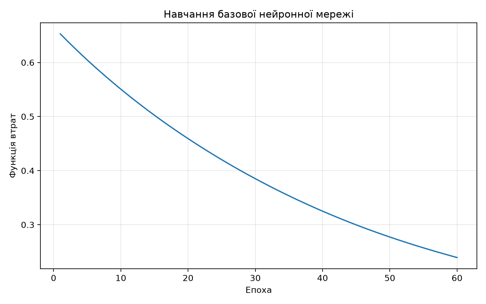
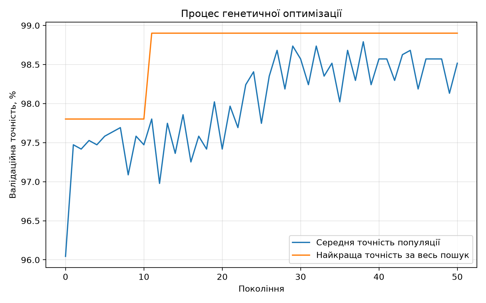
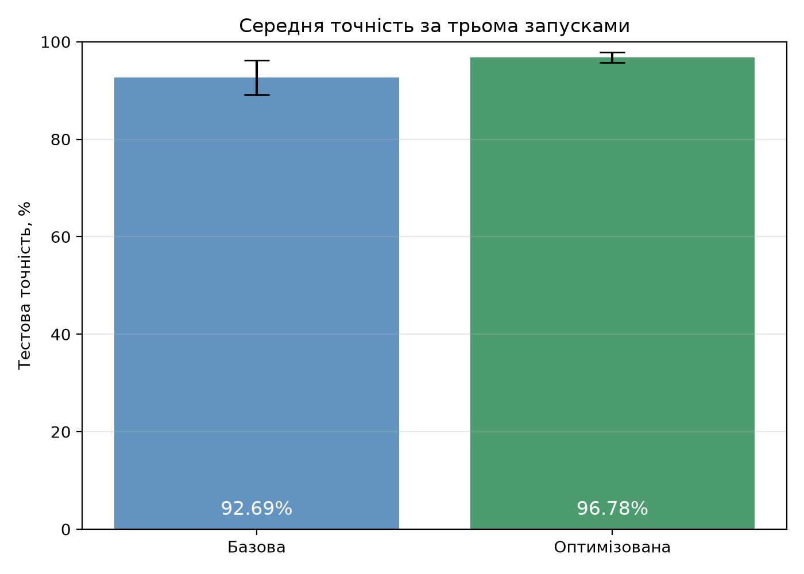

# Оптимізація гіперпараметрів нейронної мережі за допомогою генетичного алгоритму

## Мета роботи

Реалізувати нейронну мережу для класифікації та застосувати генетичний алгоритм для підбору кількості прихованих шарів, кількості нейронів, функції активації та швидкості навчання. Порівняти результати базової й оптимізованої моделей.

## Програмні засоби

Python, PyCharm, PyTorch, scikit-learn, DEAP, Matplotlib. Для обчислення середніх значень і стандартних відхилень використано стандартний модуль `statistics`.

## 1. Підготовка даних

Використано датасет Breast Cancer Wisconsin Diagnostic, завантажений функцією `load_breast_cancer()` бібліотеки scikit-learn. Датасет містить 569 прикладів із 30 числовими ознаками кожен.

| Значення цільової змінної | Клас |
|---|---|
| 0 | Злоякісне утворення — malignant |
| 1 | Доброякісне утворення — benign |

Спочатку дані поділено у співвідношенні 80/20: 455 прикладів для навчання та підбору параметрів, 114 — для остаточного тестування. Із навчальної частини додатково виділено валідаційну вибірку.

| Вибірка | Кількість прикладів | Призначення |
|---|---:|---|
| Навчальна під час пошуку | 364 | Навчання ваг кандидатів |
| Валідаційна | 91 | Оцінювання гіперпараметрів |
| Тестова | 114 | Остаточне порівняння моделей |
| Навчальна після пошуку | 455 | Фінальне навчання |

Використано `train_test_split`, `random_state=42` та стратифікацію за класами.

### Масштабування

Ознаки стандартизовано за допомогою `StandardScaler` за формулою `z = (x − μ) / σ`, де μ — середнє значення ознаки на навчальній вибірці, σ — її стандартне відхилення.

Під час пошуку параметри масштабування обчислювалися лише за 364 навчальними прикладами. Для валідаційних даних застосовувалися ті самі параметри. Ознаки перетворено на тензори `torch.float32`, а правильні відповіді — на `torch.long`.

### Особливість оцінювання

На відміну від формулювання завдання, fitness обчислювався за валідаційною, а не тестовою точністю. Це дозволило зберегти тестову вибірку незалежною від процесу вибору гіперпараметрів.

## 2. Базова нейронна мережа

Створено повнозв’язну мережу з архітектурою **30 → 16 → 2**. Після прихованого шару застосовано ReLU. Вихідний шар повертає два логіти для двох класів.

| Параметр | Значення |
|---|---|
| Кількість прихованих шарів | 1 |
| Приховані нейрони | 16 |
| Функція активації | ReLU |
| Оптимізатор | Adam |
| Швидкість навчання | 0.001 |
| Функція втрат | CrossEntropyLoss |
| Кількість епох | 60 |
| Кількість параметрів | 530 |

Уся навчальна вибірка оброблялася одним пакетом за епоху.

| Показник базового навчання | Значення |
|---|---:|
| Loss першої епохи | 0.6529 |
| Loss останньої епохи | 0.2393 |
| Навчальна точність | 95.05% |
| Валідаційна точність | 95.60% |
| Правильні валідаційні прогнози | 87 із 91 |



*Рисунок 1 — Зміна функції втрат базової моделі під час навчання на 364 прикладах.*

## 3. Представлення особини

Особина представлена хромосомою із шести генів.

| Індекс гена | Призначення |
|---|---|
| 0 | Кількість прихованих шарів |
| 1 | Індекс кількості нейронів першого шару |
| 2 | Індекс кількості нейронів другого шару |
| 3 | Індекс кількості нейронів третього шару |
| 4 | Індекс функції активації |
| 5 | Індекс швидкості навчання |

Якщо мережа має менше трьох прихованих шарів, невикористані гени ширини ігноруються.

| Гіперпараметр | Допустимі значення |
|---|---|
| Кількість прихованих шарів | 1, 2, 3 |
| Нейрони в кожному шарі | 8, 16, 32, 64 |
| Активація | ReLU, tanh |
| Швидкість навчання | 0.001, 0.003, 0.01, 0.03 |

Ваги мережі навчаються оптимізатором Adam. Генетичний алгоритм змінює гіперпараметри, а не самі ваги.

## 4. Fitness-функція

Оцінювання особини складається з розшифрування хромосоми, створення нової мережі, навчання протягом 60 епох та обчислення валідаційної точності. Точність повертається кортежем з одного значення; метою є її максимізація.

Для кандидатів використано `torch.manual_seed(42)`. Це оцінка конфігурації за однієї фіксованої ініціалізації, а не середня оцінка за кількома навчаннями.

Оцінки конфігурацій кешуються. Повторна поява тієї самої конфігурації не спричиняє повторного навчання. Ключ кешу не містить невикористаних генів.

## 5. Налаштування еволюції

| Параметр | Значення |
|---|---:|
| Розмір популяції | 20 |
| Кількість поколінь після початкової популяції | 50 |
| Розмір турніру | 3 |
| Імовірність кросоверу | 0.7 |
| Імовірність застосування мутації | 0.3 |
| Імовірність зміни гена всередині мутації | 0.2 |

Використано турнірний відбір `selTournament`, двоточковий кросовер `cxTwoPoint`, власну мутацію, цикл `algorithms.eaSimple` та `HallOfFame(1)` для збереження найкращої особини.

Початкова популяція містить базову конфігурацію. Інші особини генеруються випадково. Для кожного покоління збираються середнє, максимальне та мінімальне значення fitness. `HallOfFame` зберігає найкращу особину окремо й не означає автоматичного перенесення її до наступної популяції.



*Рисунок 2 — Середня валідаційна точність популяції та найкраща точність, отримана до поточного покоління включно.*

## 6. Найкраще знайдене рішення

Оцінено **117 унікальних конфігурацій**. Найкраща хромосома: `[1, 0, 1, 3, 1, 1]`.

Їй відповідає мережа **30 → 8 → 2**.

| Параметр | Значення |
|---|---|
| Кількість прихованих шарів | 1 |
| Приховані нейрони | 8 |
| Функція активації | tanh |
| Швидкість навчання | 0.003 |
| Кількість параметрів | 266 |
| Валідаційна точність | 98.90% |
| Правильні валідаційні прогнози | 90 із 91 |

Валідаційна точність збільшилася з 95.60% до 98.90%, тобто на **3.30 відсоткового пункту**.

## 7. Остаточне навчання та тестування

Після вибору гіперпараметрів обидві конфігурації заново навчено на всіх 455 прикладах навчальної частини. Новий `StandardScaler` навчено лише на цих прикладах. Тестові дані перетворено за отриманими параметрами.

Для кожної конфігурації виконано три навчання по 60 епох із початковими значеннями генератора 303, 404 та 505. Тестування проведено на тих самих 114 відкладених прикладах. Тестові результати не використовувалися для зміни гіперпараметрів.

| Seed | Базова модель | Оптимізована модель |
|---|---:|---:|
| 303 | 95.61% | 96.49% |
| 404 | 94.74% | 95.61% |
| 505 | 87.72% | 98.25% |
| **Середня точність** | **92.69%** | **96.78%** |
| **Стандартне відхилення, в. п.** | **3.53** | **1.09** |

Приріст середньої тестової точності становить **4.09 відсоткового пункту**.



*Рисунок 3 — Середня тестова точність за трьома запусками. Відрізки показують ± одне стандартне відхилення, а не довірчий інтервал.*

## 8. Основні функції програми

| Функція | Призначення |
|---|---|
| `create_model` | Створення мережі за заданими параметрами |
| `train_model` | Навчання ваг і зміщень |
| `evaluate_model` | Обчислення точності класифікації |
| `decode_individual` | Розшифрування хромосоми |
| `evaluate_individual` | Обчислення fitness конфігурації |
| `generate_individual` | Створення випадкової хромосоми |
| `mutate_individual` | Випадкова зміна генів |

Повний текст програми: [main.py](main.py).

## 9. Висновки

Реалізовано оптимізацію гіперпараметрів нейронної мережі за допомогою генетичного алгоритму DEAP. Найкраща знайдена конфігурація містить один прихований шар із 8 нейронами, активацію tanh і швидкість навчання 0.003.

Середня тестова точність за трьома запусками збільшилася з 92.69% до 96.78%, тобто на 4.09 відсоткового пункту. Стандартне відхилення зменшилося з 3.53 до 1.09 відсоткового пункту. Кількість параметрів мережі скоротилася з 530 до 266.

У проведеному експерименті оптимізована конфігурація показала вищу точність і менший розкид результатів. Висновки стосуються конкретного поділу даних, трьох фінальних ініціалізацій та бюджету навчання у 60 епох.

Генетичний алгоритм не гарантує знаходження глобального оптимуму. Для окремого оцінювання переваги еволюційного підходу над іншими способами підбору параметрів потрібне додаткове порівняння, наприклад із випадковим пошуком за однакового обчислювального бюджету.

## 10. Запуск

Установлення залежностей:

```bash
python -m pip install torch scikit-learn deap matplotlib
```

Запуск із папки проєкту:

```bash
python main.py
```

Програма виконує весь експеримент і зберігає таблиці та графіки в папці `results`. Числа у цьому звіті відповідають проведеному запуску; при зміні коду або середовища результати можуть відрізнятися.

## 11. Файли результатів

| Файл | Вміст |
|---|---|
| `main.py` | Повний код |
| `results/baseline_training.png` | Графік навчання базової моделі |
| `results/genetic_evolution.png` | Графік еволюції |
| `results/model_comparison.png` | Порівняння тестової точності |
| `results/test_comparison.csv` | Результати фінальних запусків |
| `results/evolution.csv` | Статистика поколінь |
| `results/summary.json` | Підсумкові параметри та результати |
